# Эталон: Rausis v2

Ролик о гроссмейстере, который жульничал из туалета (`episodes/rausis`, The 64 Files). Автор канала, 18.10.2026:
«Это просто потрясающий результат. Это именно то, что я хотел, особенно переход, где ФИДЕ наблюдает, мне понравился,
да и в принципе всё видео». Правило 45 в [STYLE_BIBLE](../STYLE_BIBLE.md): новый ролик сверять с этим по кадрам.

- 62,5 с, 14 фраз, 24 плана (в среднем 2,6 с на план), голос Callum на `eleven_v3`, сведение −16 LUFS.
- Код — `episodes/rausis/scenes.js`, текст — `script.json`, факты — [SOURCES](../episodes/rausis/SOURCES.md).
  Готовый файл — `episodes/rausis/build/rausis_toilet_v2.mp4` (в git не попадает, собирается строкой из README).
- Кадры ниже сняты с готового файла: `python3 tools/sheet.py <видео> <картинка> <секунды…>`; время — в углу кадра.

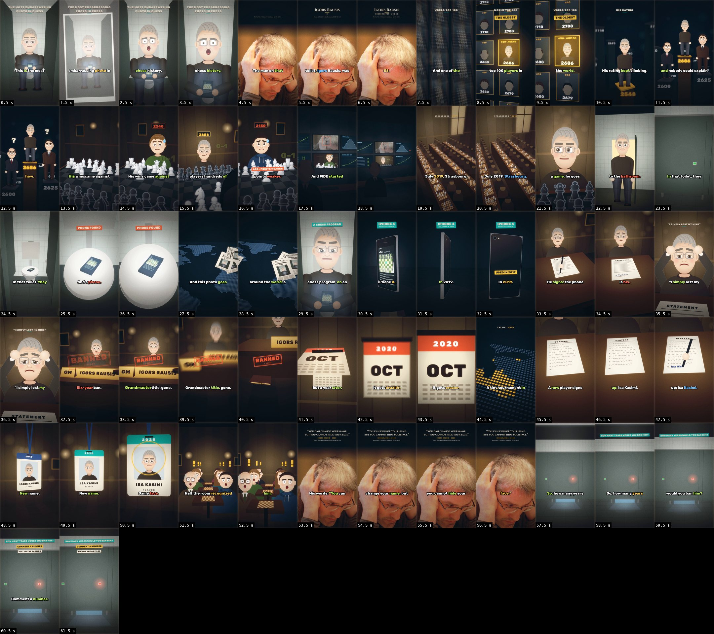

## Что в нём взять в следующий ролик

1. **Хук — развязка с первого кадра** (правило 42): он на крышке унитаза с телефоном. Этот же кадр потом работает в
   сюжете: вспышка превращает его в отпечаток, и его печатают газеты.
2. **Каждая фраза — сцена в 3D-наборе** (правило 43), и в каждом из 24 планов движется камера: наезд, проезд, кран,
   отъезд от экрана. Статичных кадров нет.
3. **Переход через экран** — главный приём ролика (ниже подробно): сцена продолжается на мониторе, камера отъезжает и
   показывает, кто на неё смотрит. Годится на любой поворот «кто-то заметил, следил, узнал».
4. **Предмет меняет состояние в кадре — это и есть новость фразы**: дверь кабинки открывается, табличка GM падает со
   стола, календарь листается, бейдж переворачивается на новое имя, ручка дописывает подпись.
5. **Цифры и даты — на предметах**, а не отдельными карточками: рейтинг на столбе, год на бейдже, месяц на календаре.
   Плашки — только на ударных словах, одна-две на план.
6. **Место из хука возвращается в финале**: туалет — хук, «goes to the bathroom», «find a phone», «a chess program»
   и вопрос в конце (кабинка заперта, из-под двери свет телефона).
7. **Настоящее фото — два раза** (имя и цитата), в 2.5D; остальное нарисовано.
8. **Звук на каждой смене**: на переходе — whoosh, на действии — звук предмета (затвор, ручка, молоток, штамп,
   страницы), перед главным ударом тишина 0,3 с и бум («phone.»). Музыка меняет раздел вместе со сценой.

## Переход «FIDE наблюдает», 16,7–18,5 с

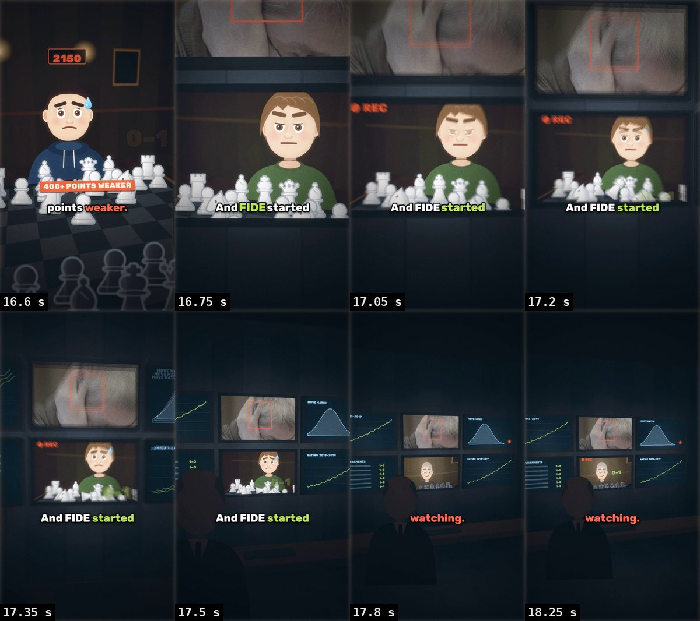

1. До 16,7 с идёт сцена побед: соперник 2150, плашка «400+ POINTS WEAKER».
2. На слове «And» (16,74 с) — склейка, которую не видно: та же партия, но уже на мониторе. Камера стоит в упор,
   экран занимает кадр; заметны только рамка и край соседнего экрана сверху (его настоящее фото в красной рамке
   распознавания).
3. С 17,05 с мигает REC, партия на экране продолжает идти — это живое видео, а не стоп-кадр.
4. За 1,5 с камера плавно отъезжает с поворотом и подъёмом: стена из шести мониторов (рейтинг 2013–2019, кривая
   совпадения ходов с компьютером с одной точкой далеко в хвосте, открытые турниры из одних «1–0», его фото в рамке
   распознавания), стол, клавиатура и аналитик FIDE спиной к нам. На «watching.» — звук `notify`.
5. 18,5 с — склейка на Страсбург.

Зритель смотрит ту же партию и вдруг понимает, что смотрит не он один. Переход объясняет сюжет без единой надписи.

Как сделано (`scenes.js`, план «AND FIDE STARTED WATCHING» и функция `monitorRoom`):

```js
const FEED = makeCanvas(), feedx = FEED.getContext('2d');   // холст, в который рисуется предыдущая сцена
shot(fideT - 0.06, (g, lt, t, sh) => {
  feedx.setTransform(1, 0, 0, 1, 0, 0); winsSet(feedx, t - wkS + 0.06, t, sideKeys, fideT - 0.1, wdt, { tags: false });
  monitorRoom(g, lt, t, [[0, K(0, 0, 5.4, [4, 3.7, 12])], [1.5, K(-0.28, 0.12, 21, [4, 4.6, 10]), ease.inOut]], FEED);
}, { noJump: true });
```

- В `FEED` каждый кадр заново рисуется сцена, шедшая до склейки, с тем же временем `t`, поэтому партия на экране
  продолжается. `tags: false` убирает плашки: на мониторе им не место.
- `monitorRoom` ставит шесть мониторов на стену `z = 12` (`MONS`). Пятый показывает полосу `FEED`
  `src: [0, 560, W, 610]` (от лица до доски), натянутую через `texQuad`. Остальные — заготовки `SCR_CHART`,
  `SCR_BELL`, `SCR_LIST`, `SCR_FACE`. В тёмной комнате (`OFFICE`) свет дают сами экраны (`pool`). Ещё в комнате
  REC, стол, клавиатура и `seated('arbiter')` спиной к камере.
- Первый ключ камеры — в упор в центр этого монитора. Поэтому первый кадр после склейки совпадает с последним до
  неё; это главное условие. Второй ключ через 1,5 с с `ease.inOut` — отъезд. `noJump: true` — без монтажных
  подзумов, они ломают непрерывный отъезд.

## Другие переходы через предметы

| Время, с | Переход | Где в коде |
|---|---|---|
| 1,3 | на «photo» вспышка и щелчок затвора, кадр замирает и становится отпечатком с белыми полями | `snapshot()` |
| 26,6 | тот же отпечаток напечатан в газетах пяти стран, газеты падают на карту мира | `PRINT`, `newspaper()`, `papersSet()` |
| 21,9; 24,4 | дверь туалета открывается — он входит; дверь кабинки открывается — на крышке телефон, камера пикирует | `bathroom({ entry, doors })` |
| 29,8–32,3 | iPhone 4 на подставке поворачивается экраном, потом спиной: «RELEASED IN 2010» → «USED IN 2019» | `iphoneSet()` |
| 33,2–34,3 | ручка дописывает подпись под «STATEMENT» | `officeSet({ sign })`, `paperAt()` |
| 37,5–39,8 | молоток, штамп «BANNED», табличка «GM» съезжает со стола и падает, камера опускается за ней | `gavelAt()`, `namePlate()` |
| 41,2–42,5 | листы календаря срываются к камере, JUL 2019 → OCT 2020, на «crazier» наезд | `calendarSet()` |
| 46,9–47,7 | рука вписывает «Isa Kasimi» десятой строкой в список участников | `sheetAt()` |
| 49,1–50,2 | бейдж на ленте переворачивается: IGORS RAUSIS 2019 → ISA KASIMI 2020, лицо то же, золотое кольцо | `badgeSet()` |
| 57,3–62,5 | финал в той же кабинке, что хук: дверь заперта, красный замок, свет телефона под дверью | `bathroom({ lockRed, glowUnder })` |

## По сценам

### 0–3,8 с · Хук: фото с первого кадра
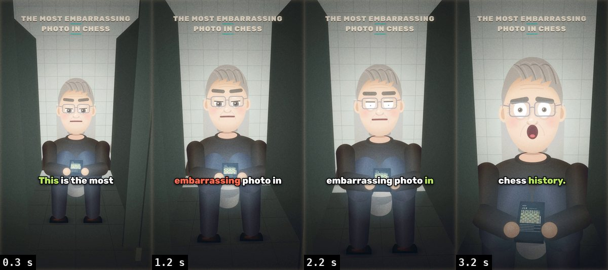

Кабинка открыта, камера влетает к нему; сверху «THE MOST EMBARRASSING PHOTO IN CHESS». На «photo» кадр становится
отпечатком, после него он поднимает глаза — шок. `hookScene` + `snapshot()`, звуки `camera`, `dun_dun`.

### 3,8–9,9 с · Кто он: настоящее фото и стена топ-100
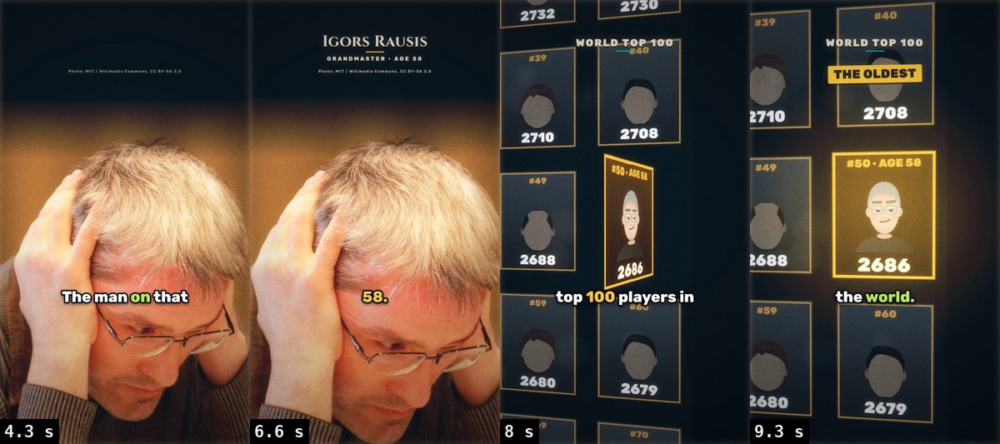

Фото Раусиса в 2.5D (`photoShot`, `nameTitle`, подпись автора снимка). Потом стена из ста рамок с рейтингами: камера
съезжает к № 50, рамка поворачивается — его лицо, золото, плашка «THE OLDEST». `topWall()`.

### 9,9–13,5 с · Рейтинг растёт
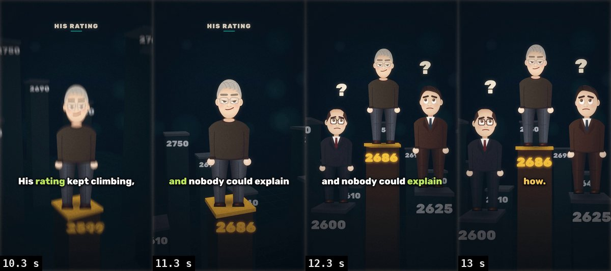

Он стоит на столбе рейтинга, столб растёт с 2500 до 2686 среди чужих столбов, камера поднимается вместе с ним. Потом
два гроссмейстера на столбах ниже смотрят вверх, над ними «?». `climbSet()`, `pillar()`, `standing()` (правило 44).

### 13,5–16,7 с · Победы над слабыми
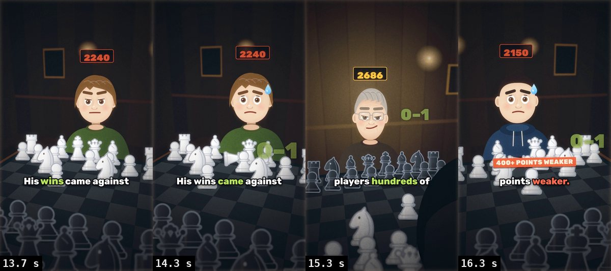

Три соперника подряд (2240, 2190, 2150), с каждым короткая партия: белый король падает, «0–1» поднимается у доски.
На «weaker.» — плашка «400+ POINTS WEAKER». `winsSet()`.

### 16,7–18,5 с · FIDE наблюдает
Разобрано выше.

### 18,5–23,4 с · Страсбург, он идёт в туалет
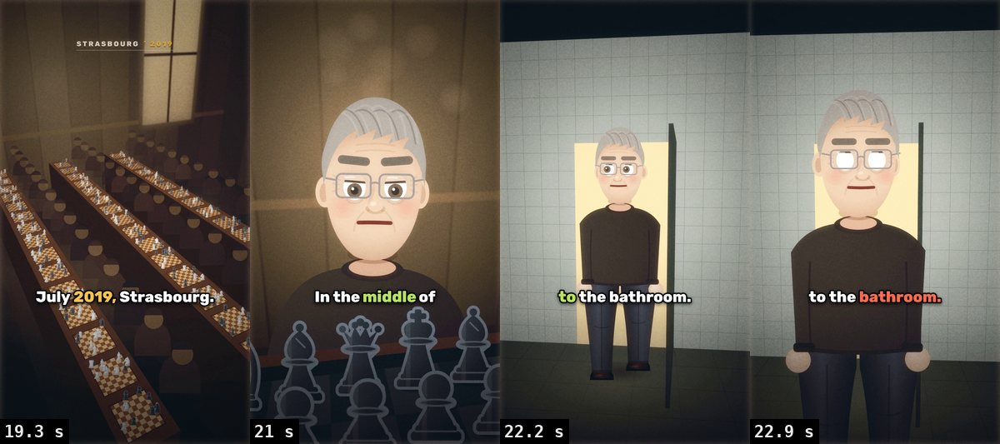

Турнирный зал сверху, ряды досок, штамп «STRASBOURG · 2019». Он за доской оглядывается. Дверь туалета открывается, он
входит, озираясь; камера ждёт у кабинок. `hall()`, `portrait()`, `bathroom({ entry })`, походка в `standing()`.

### 23,4–26,6 с · В кабинке находят телефон
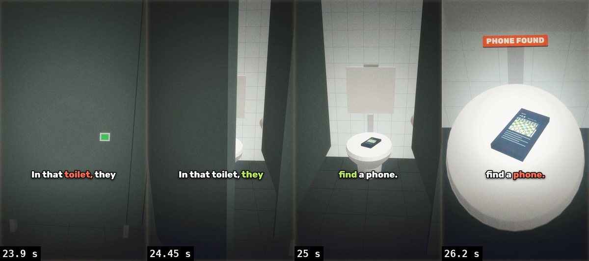

Закрытая дверь, лампа мигает, сердцебиение. Дверь открывается, камера пикирует к крышке, телефон светится. Тишина
0,3 с, бум, плашка «PHONE FOUND», музыкальный удар `slam`.

### 26,6–33,1 с · Фото облетает мир; iPhone 4
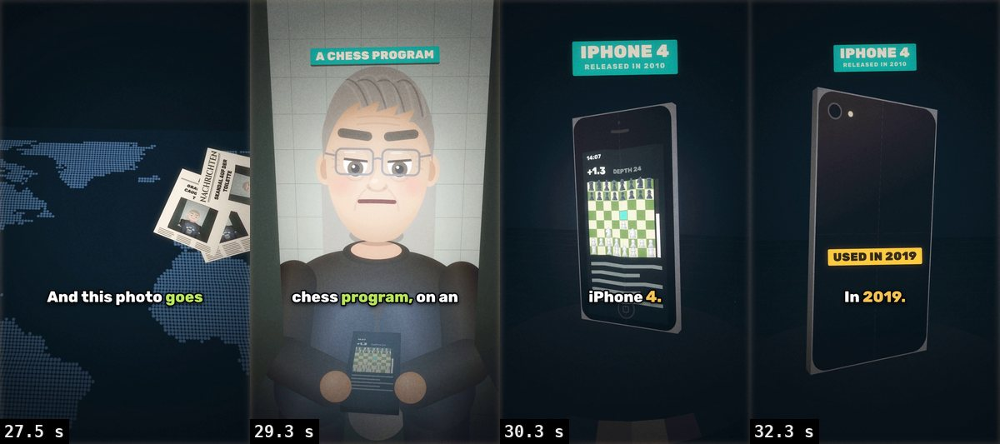

Газеты с кадром из хука падают на карту мира из точек. Он с телефоном («A CHESS PROGRAM»). iPhone 4 поворачивается на
подставке; на «4.» — скрип пластинки.

### 33,1–37,4 с · Признание
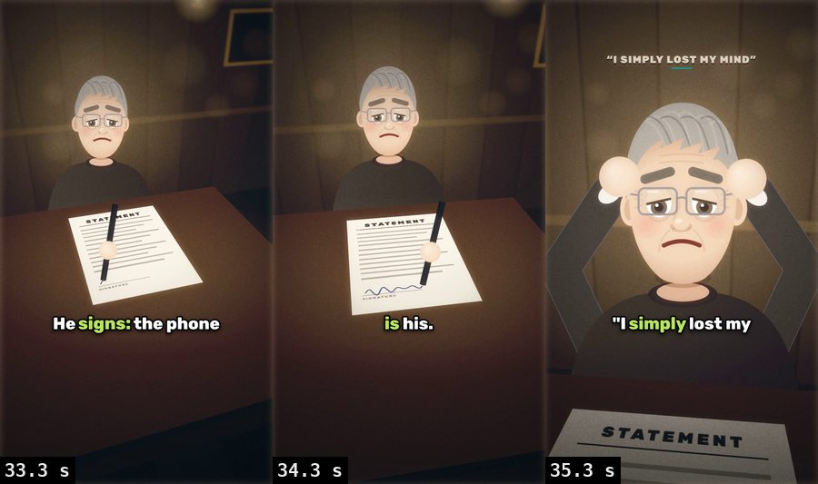

Кабинет арбитров сверху: ручка пишет подпись. Потом спереди — он хватается за голову, наверху цитата
«I SIMPLY LOST MY MIND». Музыка под этой сценой глухая (фильтр 900 Гц).

### 37,4–40,9 с · Бан
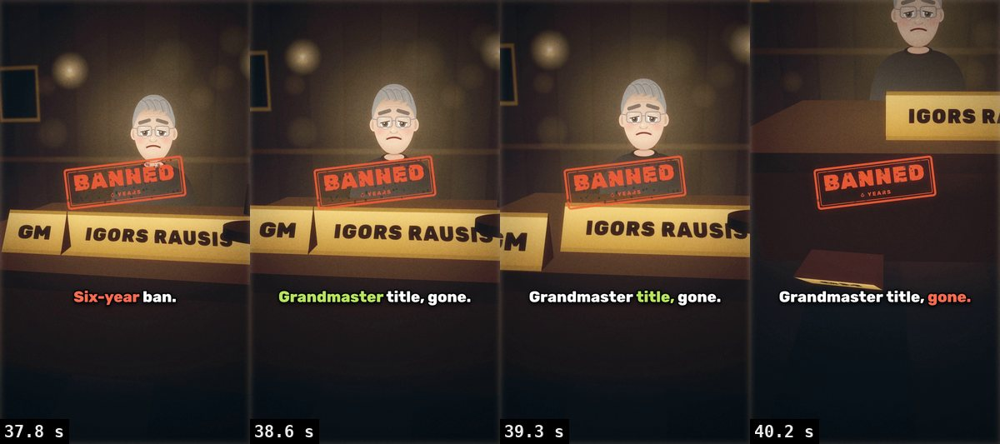

Молоток и штамп «BANNED · 6 YEARS». На «title» табличка «GM» съезжает со стола и падает, камера опускается за ней.

### 40,9–43,6 с · Год спустя
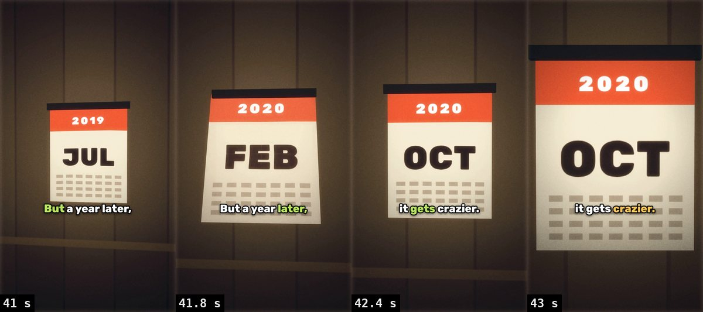

Календарь на стене листается от июля 2019 до октября 2020, на «crazier.» — наезд. Звук страниц через лист.

### 43,6–48,3 с · Латвия, новый игрок
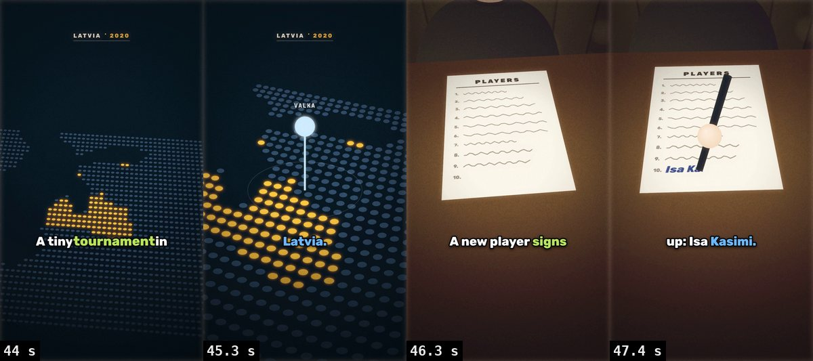

Балтика из точек, Латвия загорается, булавка на Валке. Список участников: рука вписывает «Isa Kasimi».
`balticSet()`, `sheetAt()`.

### 48,3–52,6 с · Новое имя, то же лицо
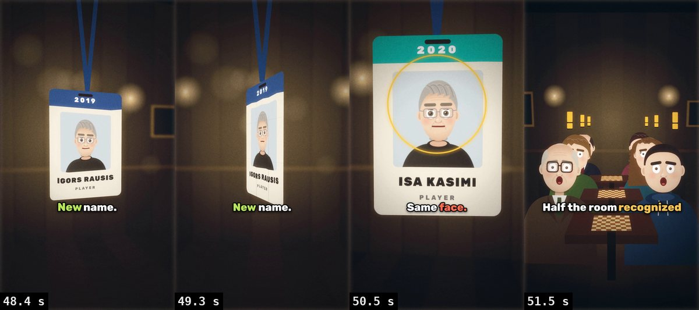

Бейдж переворачивается на новое имя, на «face.» вокруг фото — золотое кольцо. Клуб: половина зала узнаёт его («!»,
гул, вздох). `badgeSet()`, `clubRoom()`.

### 52,6–62,5 с · Его слова и финал
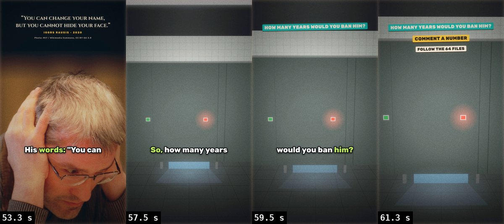

Настоящее фото и его слова «You can change your name, but you cannot hide your face». Финал — та же кабинка, что в
хуке, теперь запертая; вопрос «HOW MANY YEARS WOULD YOU BAN HIM?», «COMMENT A NUMBER», «FOLLOW THE 64 FILES»,
выключение телевизора.

## Как пересобрать раскадровку

```
python3 tools/sheet.py episodes/rausis/build/final.mp4 reference/rausis_v2/00_overview.jpg --every 1 --cols 12 --w 180
python3 tools/sheet.py episodes/rausis/build/final.mp4 reference/rausis_v2/05_fide.jpg 16.6 16.75 17.05 17.2 17.35 17.5 17.8 18.25 --cols 4 --w 300
```

Остальные полосы — по четыре кадра на сцену с `--cols 4 --w 300`, время кадров подписано на картинках.
